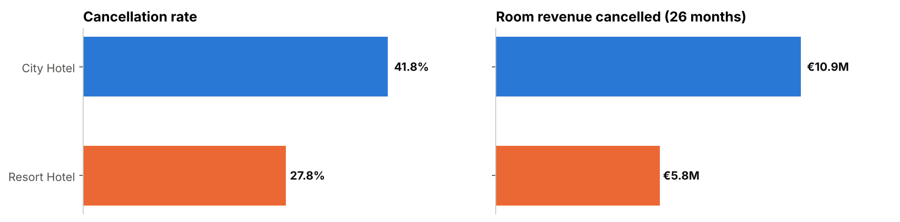
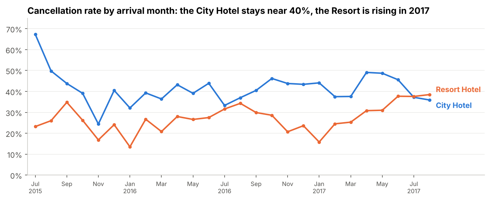
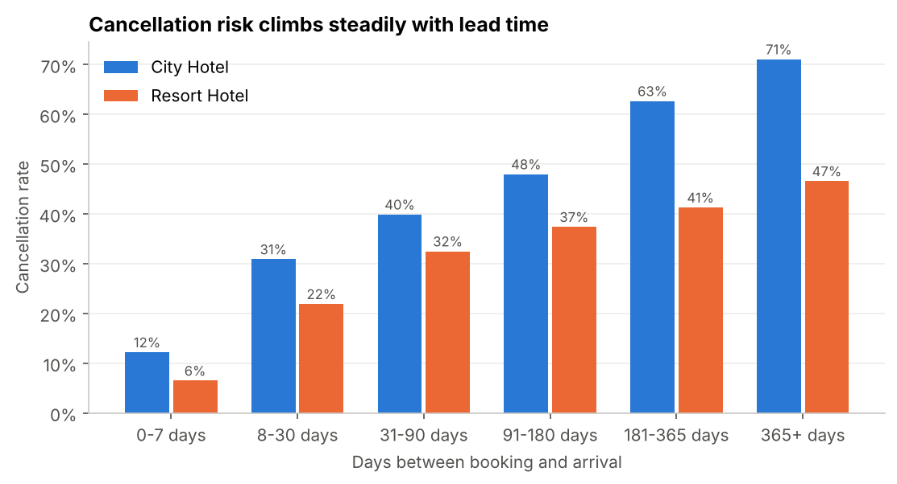
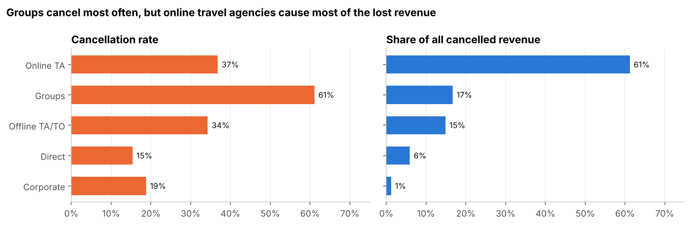
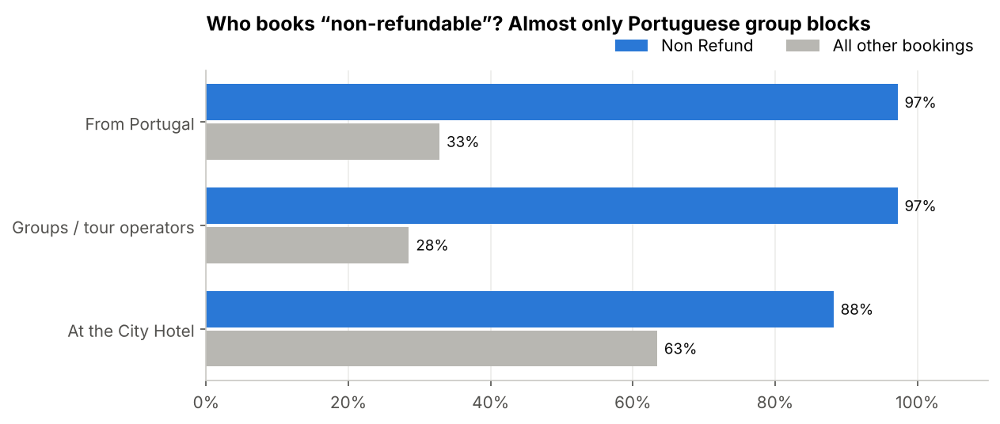
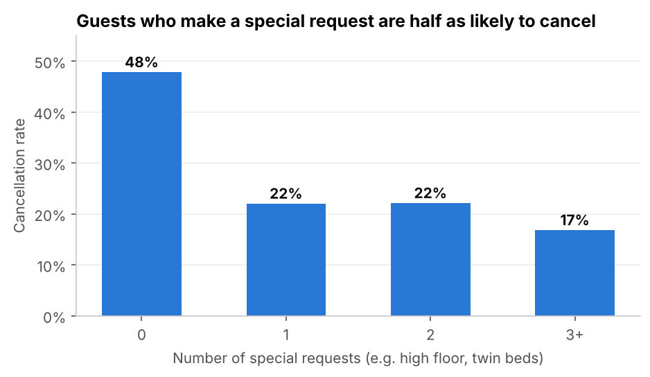
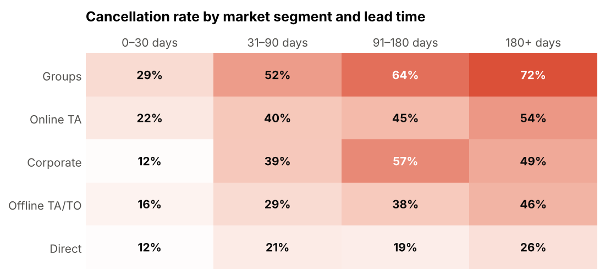
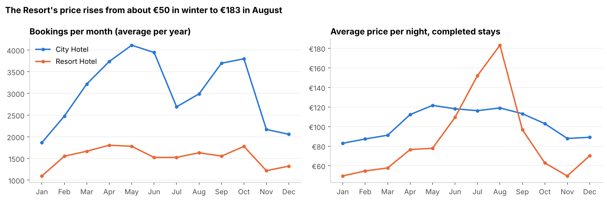
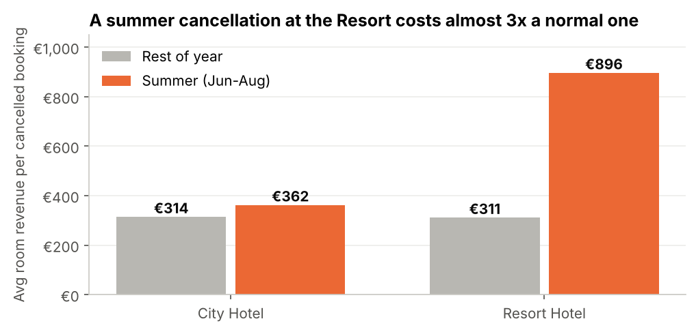
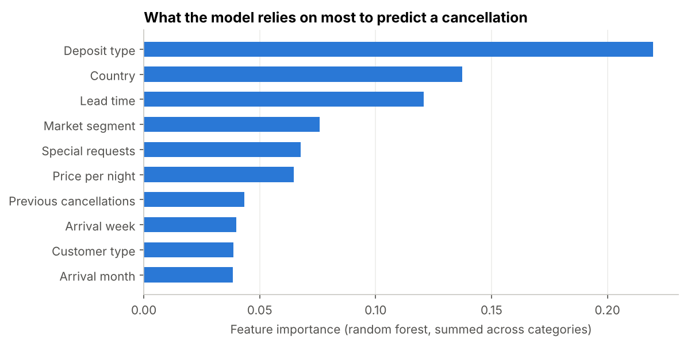

# Hotel Booking Cancellations: Drivers, Revenue at Risk & Prevention | SQL + Excel

## Overview

This project looks at 119,390 bookings from two hotels in Portugal (a City Hotel in Lisbon and a Resort Hotel in the Algarve) to understand why more than a third of reservations end up cancelled, and how much that costs. <br>

Metrics reviewed include cancellation rates, lead time, price per night (ADR), room revenue, market segments, deposit types and guest behaviour. <br>

The analysis addresses the following objectives:
+ Reviewing the structure and quality of the dataset, and cleaning it
+ Measuring the size of the cancellation problem, in bookings and in revenue
+ Finding which bookings are most likely to be cancelled (lead time, segment, deposit, country, guest behaviour)
+ Looking at seasonality, pricing and how the cost of a cancellation changes during the year
+ Giving practical recommendations to hotel management

I used SQL (SQLite) for data cleaning and analysis, and Microsoft Excel for data visualisation. <br>
The dataset can be downloaded at this [link](https://www.kaggle.com/datasets/jessemostipak/hotel-booking-demand). A copy is included in [`data/hotels.csv`](data/hotels.csv).

+ The SQL code is available [here](Hotel_Booking_Analysis_SQL_Code.sql).
+ The Excel workbook with the tables and charts is available [here](Hotel_Booking_Analysis.xlsx).

## **Table of Contents** <br>
- [Dataset](#dataset)
- [Data Cleaning](#data-cleaning)
- [Analysis](#analysis)
- [Executive Summary](#executive-summary)
- [Recommendations](#recommendations)
- [Limitations](#limitations)
- [Extra: Predicting Cancellations with Python](#extra-predicting-cancellations-with-python)

## Dataset

The data comes from the article *"Hotel booking demand datasets"* (Antonio, Almeida & Nunes, 2019, [Data in Brief, vol. 22](https://doi.org/10.1016/j.dib.2018.11.126)). These are real bookings taken from the hotels' booking systems, with personal information removed. There is one table with 32 columns, covering arrivals from July 2015 to August 2017, with guests from 177 countries.

Key columns:
+ is_canceled: whether the booking was cancelled (1) or not (0). This is what the whole analysis is about.
+ Lead time: number of days between the day the booking was made and the arrival date.
+ ADR (Average Daily Rate): average price per night, in EUR. ADR multiplied by the number of nights gives the room revenue of a booking.
+ Market segment: how the booking was made, e.g. Online Travel Agent (Booking.com and similar), Offline Travel Agent / Tour Operator, Groups, Direct, Corporate.
+ Deposit type: No Deposit, Non Refund (deposit for the full stay, not refundable) or Refundable.
+ Special requests: number of requests made by the guest (twin beds, high floor, etc.).
+ Guest history: whether the guest stayed before, and how many earlier bookings they cancelled.
+ Reservation status: final status of the booking: Check-Out, Canceled or No-Show.

One thing to keep in mind: 2016 is the only full year in the data (2015 starts in July and 2017 ends in August). Comparing yearly totals would be misleading. For example, 2017 has 28% fewer bookings than 2016 in total, but over the same months (January to August) bookings actually grew by 10.6%. For this reason I worked with monthly figures and same-period comparisons.

## Data Cleaning

I created a typed table, imported the CSV and ran some quality checks before starting the analysis (queries 2.1 to 2.5).

| Check | Rows | Decision |
|---|---:|---|
| Missing `children` | 4 | Replaced with 0 |
| Missing `country` | 488 | Kept and labelled *Unknown* (the booking itself is fine) |
| Missing `agent` / `company` | 16,340 / 112,593 | Kept. Here a missing value just means the booking was made without an agent or company |
| Bookings with 0 guests | 180 | Removed, a booking with nobody staying is not a real booking |
| Negative price, or price above €1,000 per night | 2 | Removed as data-entry errors. One row had a price of €5,400 per night, while the next highest price is €510 |
| Price of €0 | 1,959 | Kept. About a third are complimentary (free) stays and about a third are 0-night bookings, so these are real records |
| Identical rows | ~32,000 | Kept. There is no booking ID, so identical rows are expected for group bookings made on the same day at the same price. Removing them would undercount groups |

182 rows (0.15%) were removed, leaving 119,208 bookings. The rest of the queries run on a view (`bookings_clean`) that also adds a few calculated columns: total nights, total guests, month number and booking value (price per night × nights).

## Analysis

I started by calculating the main KPIs for each hotel.

The average booking looks like this:
+ Price per night: €101.93
+ Lead time: 104 days
+ Length of stay: 3.4 nights

Out of all bookings, 62.9% checked out, 36.1% were cancelled and 1.0% were no-shows (`is_canceled` counts both cancellations and no-shows). So more than one in three bookings never turns into a stay.

| Hotel | Bookings | Cancelled | Cancellation rate | Booked room revenue | Revenue cancelled | % of revenue cancelled |
|---|---:|---:|---:|---:|---:|---:|
| City Hotel | 79,162 | 33,078 | 41.8% | €25.3M | €10.9M | 43.1% |
| Resort Hotel | 40,046 | 11,120 | 27.8% | €17.4M | €5.8M | 33.5% |
| **Total** | **119,208** | **44,198** | **37.1%** | **€42.7M** | **€16.7M** | **39.2%** |



Over the 26 months in the data, €16.7M of booked room revenue was cancelled, around €7.7M a year. This is an upper bound, since some of these rooms were probably sold again, but it gives an idea of the size of the problem. About two thirds of it comes from the City Hotel.

A detail worth noting: 37.1% of bookings were cancelled, but 39.2% of the booked revenue was. Cancelled bookings are, on average, worth more than the ones that are kept.

Next I looked at the cancellation rate over time. Since December 2015 the City Hotel has stayed between 32% and 49% every month. The Resort is lower, but it has been going up: each month from March to August 2017 had a higher rate than the same month in 2016, reaching 38.5% in August 2017.



Then I moved on to which bookings get cancelled. The clearest pattern is lead time. Bookings made within a week of arrival were cancelled 9.6% of the time. The rate goes up with every bucket, to 55.5% for bookings made 6 to 12 months ahead and 67.7% for bookings made more than a year ahead. Both hotels show the same pattern, but it is much steeper at the City Hotel (71% for 365+ days, against 47% at the Resort).



For market segments, the answer depends on the question:
+ Who cancels most often? Groups (61.1%), then Online Travel Agents (36.8%) and Offline Travel Agents / Tour Operators (34.3%). Direct (15.4%) and Corporate (18.8%) bookings are the most reliable.
+ Who accounts for most of the cancelled revenue? Online Travel Agents, with 61.2% of it (€10.2M). Their rate is close to the average, but they are by far the biggest channel.



The deposit type gave the most surprising result. Bookings with a non-refundable deposit were cancelled 99.4% of the time (14,586 bookings), against 28.4% for bookings with no deposit. A deposit is supposed to do the opposite, so I checked who these bookings are (query 4.4):

| Profile | Non Refund | All other bookings |
|---|---:|---:|
| From Portugal | 97.2% | 32.8% |
| Groups / Tour Operators | 97.2% | 28.5% |
| Average lead time | 213 days | 89 days |
| Average special requests | 0.00 | 0.65 |
| At the City Hotel | 88.2% | 63.4% |



These don't look like individual guests losing their money. Almost all of them are bookings from Portuguese tour operators and groups, made about 7 months in advance and without a single special request. My reading is that these are room blocks held by tour operators and released when they were not filled, and that the non-refundable condition is not actually enforced on them. If that is right, it is a contract issue and not a guest behaviour issue. This should be confirmed with the sales and finance teams.

This also explains most of Portugal's high cancellation rate. Portugal is the biggest market (48,482 bookings) with a 56.7% cancellation rate, but without the non-refundable blocks it drops to 39.0%. That is still the highest among the top markets, but closer to Italy (35.4%) and Brazil (37.4%). The UK, France and Germany cancel only 17% to 20% of the time.

Next, guest behaviour and history:

| Signal | Cancellation rate if yes | Cancellation rate if no |
|---|---:|---:|
| Guest made at least one special request | 21.8% | 47.8% |
| Repeat guest | 14.7% | 37.8% |
| Guest cancelled a booking before | 91.7% | 33.9% |

Guests who made a special request (high floor, cot, twin beds) cancelled less than half as often as guests who didn't. Repeat guests had the lowest rate of all. Guests with a previous cancellation usually cancel again: 6,479 bookings, 91.7% of them cancelled.



Note: bookings with a car parking request show a 0% cancellation rate. I didn't use this as a finding. Parking seems to be recorded at check-in, so only guests who actually arrived can have it.

To see where the risk factors overlap, I put market segment and lead time together in one table (query 4.8, formatted as a heat map in Excel). The worst combination is groups booked more than 180 days ahead (72%). Direct bookings stay between 12% and 26% whatever the lead time, so for direct bookers an early booking is not a big risk.



Finally, seasonality and price. Demand at the City Hotel peaks in spring (May, 4,111 bookings a year) and autumn, with a dip in July, and the price stays between €83 and €122 per night. The Resort's price is much more seasonal, going from about €50 per night in January to €183 in August.



This means a cancellation does not always cost the same. An average cancelled summer booking at the Resort is worth €896, almost three times a cancellation in the rest of the year (€311). July and August alone account for €3.0M, 52% of all the Resort's cancelled revenue. At the City Hotel the cancelled revenue is spread more evenly, with May, June and August each above €1.3M.



## Executive Summary

+ 37.1% of bookings were cancelled, worth €16.7M of booked room revenue over 26 months (39.2% of everything booked, around €7.7M a year). The City Hotel cancels 41.8% of its bookings and accounts for two thirds of that amount.
+ Lead time is the clearest warning sign. The cancellation rate goes from 9.6% for last-minute bookings to 67.7% for bookings made more than a year ahead.
+ The non-refundable deposit doesn't work as expected. 14,586 non-refundable bookings were cancelled 99.4% of the time, and almost all of them are Portuguese tour operator and group blocks booked around 7 months ahead. They also push Portugal's cancellation rate from 39% up to 57%.
+ Online Travel Agents account for 61% of the cancelled revenue, even though Groups cancel more often. Direct and corporate bookings are the most reliable (15% to 19%).
+ Guests who are engaged with their stay keep their bookings: 21.8% cancellation with a special request against 47.8% without, and 14.7% for repeat guests. Guests who cancelled before cancel again 91.7% of the time.
+ The cost of a cancellation depends on the season. At the Resort a summer cancellation is worth about 3x a winter one, and July and August make up half of its cancelled revenue. The Resort's cancellation rate also went up in 2017.

## Recommendations

I grouped the recommendations into three areas: contracts and policies, sales channels and guests, and revenue management.

**Contracts and policies**
+ Review the contracts with tour operators and groups. The non-refundable bookings that are cancelled 99% of the time look like room blocks held by tour operators. I would add a release date (for example 30 days before arrival), after which rooms that were not released are charged, and check with finance whether the deposits on these contracts are actually collected. Either the hotel gets the deposit, or it gets the rooms back early enough to sell them again.
+ Link the cancellation policy to lead time and season. Last-minute bookings rarely cancel and can keep free cancellation. Bookings made 90+ days ahead, and Resort bookings for June to August, could require a partial deposit or have a free-cancellation deadline. This targets the bookings that are both the most likely to cancel and the most valuable.

**Sales channels and guests**
+ Grow direct bookings and depend less on Online Travel Agents. OTAs account for 61% of the cancelled revenue, while direct bookings cancel at less than half the rate (15.4%) and don't carry a commission. A "book direct" benefit (best price, free breakfast, flexible check-in) and a simple offer for repeat guests could move more bookings to the more reliable channels.
+ Get in touch with guests after they book. Guests who make a special request cancel half as often. A pre-arrival email asking guests about their preferences (bed type, arrival time, room location) is cheap to send. Since this is a correlation, I would test it first on part of the bookings (A/B test) before rolling it out.
+ Ask for a deposit or card guarantee from guests who cancelled before, since 91.7% of their bookings end up cancelled.

**Revenue management**
+ Reconfirm high-risk bookings before arrival. Bookings with a long lead time, from Groups or OTAs, with no special requests or from guests with a previous cancellation could get a reconfirmation request 2 to 4 weeks before arrival. Rooms with no answer can be released while there is still time to sell them.
+ Plan overbooking at the City Hotel based on data. The cancellation rate there has been stable at around 40%, so the hotel can overbook with more confidence, based on the expected cancellations per night for each segment and lead time instead of a fixed percentage.
+ Keep an eye on the Resort's cancellation rate, which went up in 2017, especially in summer, where each cancellation is worth around €900.

In conclusion, most cancellations can be predicted from information that is already available when the booking is made. Fixing the group contracts, changing the deposit policy by lead time and season, and moving more bookings to direct and repeat guests could protect a good part of the ~€7.7M of revenue cancelled every year.

## Limitations

Although the analysis gives useful insights, it has some limitations:
+ The data covers only two hotels in one country, from 2015 to 2017. Booking habits have changed since then, especially after COVID-19 and with free cancellation becoming more common, so the patterns should be checked on more recent data.
+ The cancelled revenue is an upper bound. The data doesn't show whether a cancelled room was sold again, so the real loss is lower.
+ There is no booking ID, so I couldn't confirm whether identical rows are separate bookings.
+ I didn't analyse when bookings are cancelled. For cancelled bookings, `reservation_status_date` is the cancellation date, so a next step would be to measure how many days before arrival guests cancel. This would show how much time the hotel has to sell the room again.
+ The results are correlations. For example, special requests may be a sign that the guest is committed rather than the reason they keep the booking. Recommendations based on them should be tested first.
+ There is no cost data. OTA commissions, the cost of overbooking and the deposits actually collected would be needed to estimate the financial impact of each recommendation.

## Extra: Predicting Cancellations with Python

As an extra step, I trained a model in Python ([notebook](notebooks/hotel_cancellations_analysis.ipynb)) to see if cancellations can be predicted at the moment of booking. I left out every column that is only known after the booking is made (reservation status, parking, room assignment, booking changes), so the model doesn't "see the answer".

| Model | ROC AUC (test set) |
|---|---:|
| Logistic regression (baseline) | 0.87 |
| Random forest | 0.94 |

The 20% of bookings the model rated as riskiest were cancelled 97% of the time, and they include 53% of all cancellations. In practice this could be the list of bookings to reconfirm. The most important features were deposit type, country, lead time, market segment, special requests and price, the same factors found in the SQL analysis.



---

### Repository structure

```
├── README.md
├── Hotel_Booking_Analysis_SQL_Code.sql     # SQL analysis (cleaning + all queries)
├── Hotel_Booking_Analysis.xlsx             # Excel workbook with query results and charts
├── data/
│   └── hotels.csv                          # raw dataset
├── images/                                 # charts used in this README
└── notebooks/
    └── hotel_cancellations_analysis.ipynb  # Python EDA and prediction model
```
